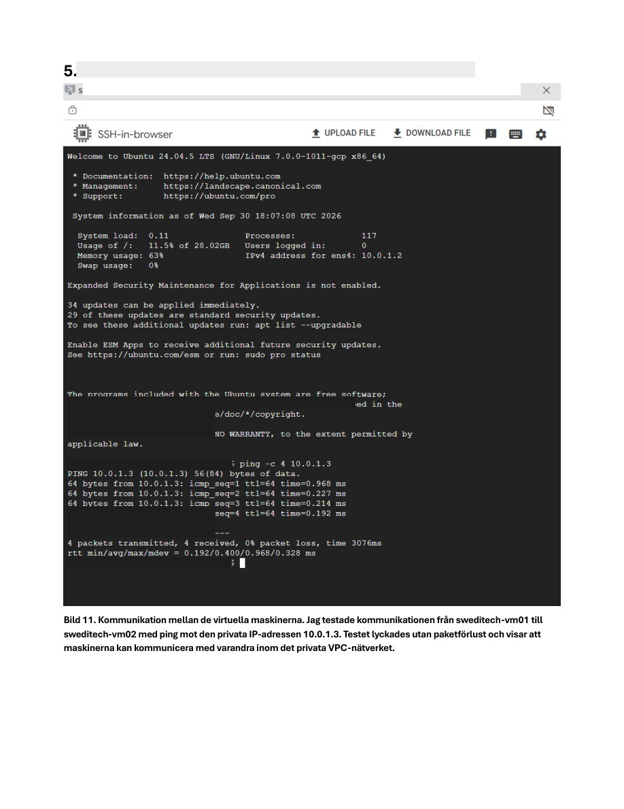

# Google Cloud Infrastructure Lab

<p align="left">
  
</p>


> **Hands-on Google Cloud infrastructure project** demonstrating private VM networking, Ubuntu administration, shared Cloud Storage access through FUSE, IAM troubleshooting, and private connectivity to a managed SQL Server database.

## Project Summary

This repository documents a practical Google Cloud lab for the fictional company **Sweditech AB**. The environment, named **Sweditech-GCP**, combines two Ubuntu Compute Engine virtual machines, a shared Cloud Storage bucket and a managed Cloud SQL for SQL Server instance.

The main goal was to connect these components, verify that the services worked and troubleshoot issues encountered during the configuration.

### Key outcomes

- Created the Sweditech-GCP project and a VPC network
- Deployed two Ubuntu virtual machines using Compute Engine
- Configured VPC firewall rules and tested private VM-to-VM communication
- Created the Cloud Storage bucket **sweditech-delad-lagring**
- Mounted the bucket on both VMs using **Cloud Storage FUSE (gcsfuse)**
- Investigated and resolved a storage **Permission denied** problem
- Reviewed service-account permissions, IAM and API access configuration
- Configured **Cloud SQL for SQL Server 2022 Standard** with private connectivity
- Verified TCP 1433 reachability and used **sqlcmd** to test the database
- Created and tested **SweditechDB**

## Technology Stack

`Google Cloud` · `Compute Engine` · `VPC` · `VPC Firewall` · `Ubuntu` · `Linux` · `Cloud Storage` · `gcsfuse` · `IAM` · `Cloud SQL` · `SQL Server 2022` · `sqlcmd` · `gcloud CLI`

---

## Architecture

```text
                  Sweditech-GCP
                        |
                  VPC / subnet
                  Firewall rules
                        |
            +-----------+-----------+
            |                       |
            v                       v
     Compute Engine VM01     Compute Engine VM02
          Ubuntu                  Ubuntu
            |                       |
            +---- Private VM -------+
            |     connectivity
            |
            +---------+-------------+
                      |
                      v
               Cloud Storage
           sweditech-delad-lagring
             Mounted via gcsfuse
                on both VMs

            Ubuntu VM / sqlcmd
                      |
                 Private VPC
                 TCP port 1433
                      |
                      v
                 Cloud SQL
           SQL Server 2022 Standard
                 SweditechDB
```

The diagram summarizes the components used in the lab. Cloud Storage is an object-storage service exposed through a FUSE mount, not a traditional shared block disk.

## VPC and Virtual Machines

A VPC network and subnets were configured for the Google Cloud environment. Two Ubuntu Compute Engine instances were deployed and used for network and storage tests.

### Compute Engine VM01

VM01 was used for connectivity checks, accessing the shared Cloud Storage bucket and working with the Google Cloud services from Linux.

### Compute Engine VM02

VM02 was used as the second machine for private-network and shared-storage validation. Having two instances made it possible to test whether the same bucket contents were accessible from more than one VM.

### Private connectivity

VPC firewall rules were configured and the machines were tested using ping over their private network addresses.



A ping test confirms ICMP connectivity, but not database or storage permissions. Those were validated in separate steps.

## Network and Access Controls

The lab involved two different kinds of access control:

1. **VPC firewall rules** for network traffic between Compute Engine instances and the required services
2. **IAM and service-account permissions** for access to Google Cloud resources such as Cloud Storage

These controls solve different problems. A working network connection does not automatically grant permission to read or write objects in a bucket.

For a production environment, permissions should be limited to the identities and resources that require them, and firewall source ranges should be reviewed carefully.

## Shared Cloud Storage

The bucket **sweditech-delad-lagring** was created to provide storage that both Ubuntu VMs could access.

Cloud Storage FUSE (**gcsfuse**) was used to mount the bucket into the Linux filesystem on each VM.

### Storage workflow

1. Create the Cloud Storage bucket
2. Prepare Cloud Storage FUSE on the Ubuntu instances
3. Mount the bucket on VM01 and VM02
4. Create a test file from VM01
5. Verify that VM02 can access the same file

This demonstrated shared access to bucket objects through filesystem-style mounts.


### Storage design note

Cloud Storage is object storage, even when accessed through gcsfuse. Its behavior is not identical to a conventional local filesystem or a Windows SMB share. The lab tested the shared-file workflow required for this exercise.

## IAM Troubleshooting

During the storage setup, a **Permission denied** error occurred when attempting to write to the mounted bucket.

The troubleshooting involved checking:

- The service account associated with the VM
- IAM permissions relevant to bucket access
- API access configuration
- Whether the mounted storage could be used for the intended write operation

After reviewing the access configuration, the storage test succeeded.

This was an important part of the project because it showed that storage problems may be caused by identity and permissions rather than networking alone.

## Cloud SQL for SQL Server

A managed **Cloud SQL for SQL Server 2022 Standard** instance was configured with private network connectivity.

Unlike SQL Server installed directly on a VM, Cloud SQL is a managed database service. The lab therefore focused on connecting the Ubuntu environment to the database service rather than administering a Windows SQL Server host.

### Database connectivity

The connection was tested from Ubuntu using the SQL Server client tooling and private network access.

TCP port **1433** was used for SQL Server connectivity.

The lab included:

- Checking whether the SQL Server endpoint was reachable
- Connecting using **sqlcmd**
- Verifying database access and SQL permissions
- Creating **SweditechDB**
- Inserting and retrieving test records


## Connectivity Validation

The SQL connectivity test checked TCP 1433 between the Ubuntu VM and the private Cloud SQL endpoint.

A successful port check confirmed that the database endpoint was reachable over the configured network path. The subsequent sqlcmd tests checked that SQL Server could also be accessed at the application level.


The private endpoint is intentionally redacted in the public screenshot. The relevant test command, port and result remain visible.

## Troubleshooting and Verification

Several independent layers were validated in the Google Cloud environment:

| Area | What was checked |
|---|---|
| Compute Engine | Two Ubuntu VMs deployed |
| VPC networking | Private VM-to-VM ping |
| Cloud Storage | Bucket mounted on both VMs |
| Storage permissions | IAM/service-account configuration after Permission denied |
| Cloud SQL networking | TCP 1433 reachability |
| SQL Server | sqlcmd connection and database operations |

The storage permission issue was particularly useful for distinguishing **authentication and authorization** from network reachability.

The project also involved Linux repository configuration troubleshooting while preparing the environment.

## Validation Checklist

- [x] Google Cloud project created
- [x] VPC and firewall rules configured
- [x] Two Ubuntu Compute Engine VMs deployed
- [x] Private VM-to-VM connectivity verified
- [x] Cloud Storage bucket created
- [x] Bucket mounted using gcsfuse on both VMs
- [x] Shared test file accessed across the VMs
- [x] Storage permission issue investigated and resolved
- [x] Cloud SQL for SQL Server configured
- [x] Private TCP 1433 reachability verified
- [x] SQL connection tested with sqlcmd
- [x] SweditechDB created and test data verified

## Security Considerations

This is an educational lab, not a production deployment. Production use would require a review of IAM least privilege, service-account permissions, private connectivity, firewall rules, database authentication, logging and backup configuration.

Sensitive addresses and identifying details have been redacted from selected public screenshots. Credentials and access tokens are not intentionally documented here.

## What I Learned

This project provided hands-on experience with Google Cloud networking, Linux virtual machines, shared object storage and managed databases.

The most valuable troubleshooting exercise was resolving storage access problems by investigating IAM and service-account configuration. It also reinforced why a successful ping or TCP connection does not automatically prove that a user or service has permission to access a resource.

The Cloud SQL exercise demonstrated the difference between checking a network port and successfully running SQL commands against a managed database.

## Project Status

**Practical lab completed.** This repository contains selected documentation and screenshots from the original implementation.

---

*Built as a hands-on cloud and infrastructure lab for portfolio and learning purposes.*