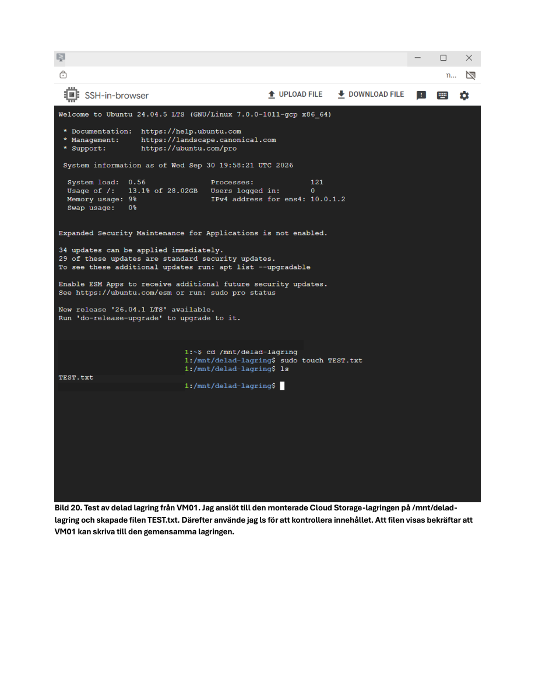
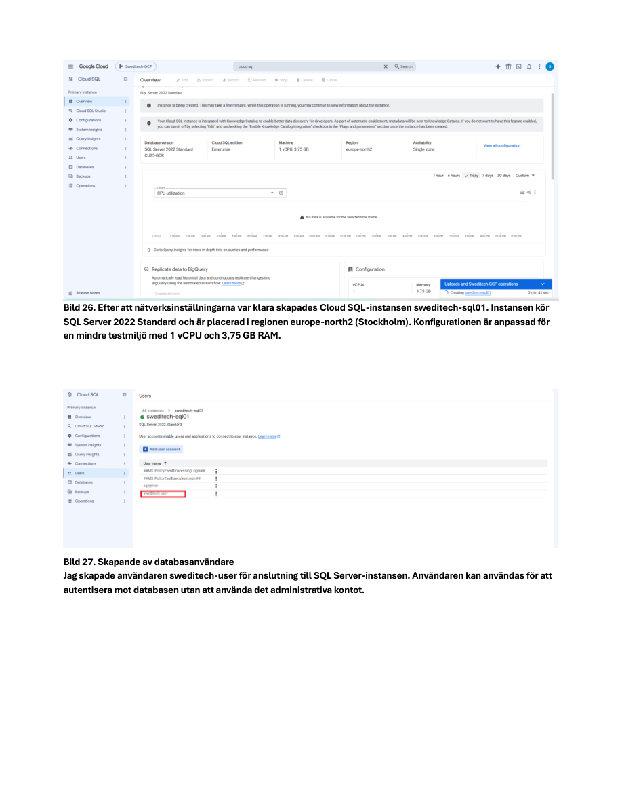
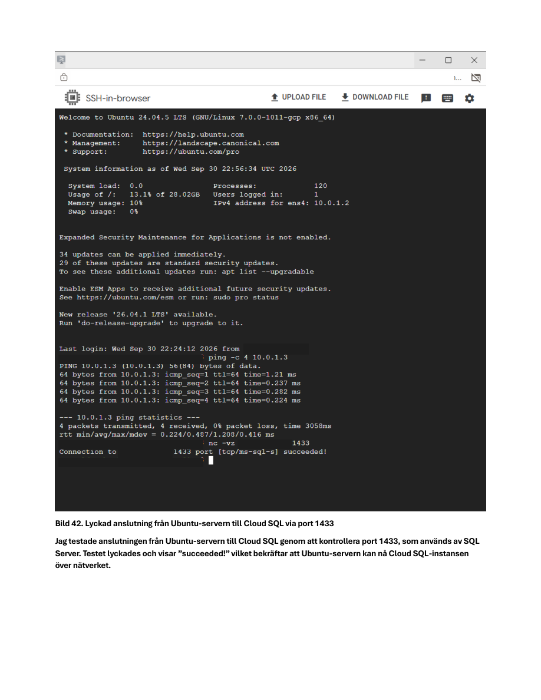

# Google Cloud Infrastructure Lab


> **Hands-on Google Cloud project:** building private VM networking, shared Cloud Storage mounts and a SQL Server database with connectivity and permissions validation.

## Project Overview

This lab documents the **Sweditech-GCP** environment built for the fictional company Sweditech AB. It connects virtual machines, object storage and a managed SQL Server database while testing networking, access control and troubleshooting.

## Architecture

```text
Google Cloud project: Sweditech-GCP
  |
  +-- VPC / subnet / firewall rules
  |     |
  |     +-- Compute Engine VM01 (Ubuntu)
  |     +-- Compute Engine VM02 (Ubuntu)
  |             |
  |             +-- Private VM-to-VM connectivity
  |
  +-- Cloud Storage bucket: sweditech-delad-lagring
  |     +-- Mounted on both VMs with Cloud Storage FUSE
  |     +-- Shared-file write/read validation
  |
  +-- Cloud SQL: SQL Server 2022 Standard
        +-- Private IP connectivity
        +-- SweditechDB
        +-- sqlcmd connection and query tests
```

## Technologies

Google Cloud · Compute Engine · VPC · VPC Firewall Rules · Ubuntu · Cloud Storage · Cloud Storage FUSE (gcsfuse) · IAM · Cloud SQL for SQL Server · sqlcmd · gcloud CLI

## Implementation

### 1. Virtual network and compute
- Created the Google Cloud project **Sweditech-GCP**.
- Built a VPC with subnets and deployed two Ubuntu virtual machines.
- Applied firewall rules and verified VM-to-VM private connectivity with ping.

### 2. Shared Cloud Storage
- Created the bucket **sweditech-delad-lagring**.
- Mounted the bucket on both virtual machines using **Cloud Storage FUSE**.
- Created a test file from VM01 and verified that VM02 could access it.

### 3. Identity and troubleshooting
- Investigated a **Permission denied** error when writing to the mounted bucket.
- Checked the VM's service account and IAM permissions.
- Investigated API access configuration and resolved the storage-access problem.

### 4. Managed SQL Server
- Configured **Cloud SQL for SQL Server 2022 Standard** with private network access.
- Connected from the Ubuntu VM using **sqlcmd**.
- Verified database identity, network reachability on TCP 1433, and SQL permissions.
- Created, inserted and read test data in **SweditechDB**.

## Validation Results

| Test | Result |
|---|---|
| VM01 to VM02 private ping | Successful |
| Shared Cloud Storage file access | Successful |
| Ubuntu to Cloud SQL TCP 1433 | Successful |
| SQL database connection via sqlcmd | Successful |
| Insert and read test data | Successful |

## What This Project Demonstrates

- Google Cloud VPC networking and Compute Engine administration
- Cross-VM shared storage using Cloud Storage FUSE
- Troubleshooting Linux repository configuration and IAM access
- Private connectivity to managed SQL Server
- Testing SQL permissions and verifying application-level functionality


## Lab Screenshots

**Cloud Storage FUSE validation**



**Cloud SQL configuration**



**Ubuntu to Cloud SQL connectivity test (TCP 1433)**




---

*Educational infrastructure lab; not a production deployment.*